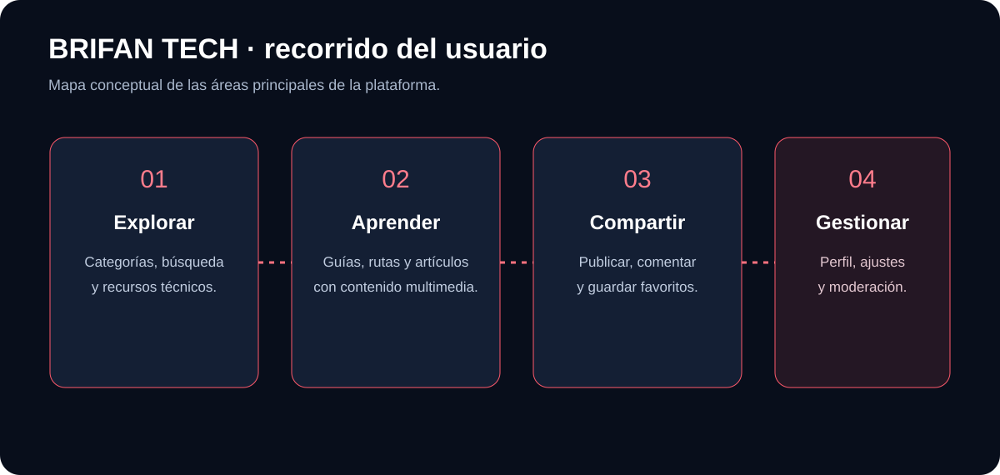

<div align="center">


# BRIFAN TECH

### Explora. Aprende. Comparte.

**Una plataforma web comunitaria para descubrir, estudiar y compartir conocimiento tecnológico.**

[🌐 Abrir plataforma](https://josefro.github.io/BRIFAN-TECH/) · [📂 Código fuente](https://github.com/JOSEFRO/BRIFAN-TECH) · [🐛 Reportar un problema](https://github.com/JOSEFRO/BRIFAN-TECH/issues)

</div>

## ¿Qué es BRIFAN TECH?

BRIFAN TECH organiza recursos y publicaciones sobre redes, ciberseguridad, programación, inteligencia artificial, sistemas y otras áreas de tecnología. Está pensada para lectores y autores que desean aprender y compartir material desde una misma web.

**No necesitas instalar nada para utilizar la plataforma pública:** se abre directamente desde el navegador.

## Recorrido de la plataforma



| Área | Para qué sirve |
|---|---|
| Explorar | Descubrir categorías, recursos y publicaciones. |
| Leer y aprender | Consultar guías, tutoriales y contenido multimedia. |
| Cuenta de usuario | Acceder a funciones que requieren autenticación. |
| Publicar | Redactar contenido, adjuntar recursos y enviarlo a revisión. |
| Comunidad | Comentar y guardar favoritos, según permisos habilitados. |
| Gestión | Consultar publicaciones propias y herramientas de moderación según el rol. |

## Características del producto

- Biblioteca organizada por categorías tecnológicas.
- Editor de artículos con formato, enlaces, imágenes y vista previa.
- Autenticación de usuarios mediante Supabase Auth.
- Flujo de revisión y moderación de publicaciones.
- Comentarios y favoritos para usuarios autenticados.
- Archivos adjuntos privados mediante enlaces firmados de Supabase Storage.
- Preferencias de usuario y opciones de personalización.
- Interfaz responsive con dirección visual obsidiana y violeta eléctrico, manteniendo el logotipo original. El lector técnico admite encabezados, listas, tablas, bloques de código, imágenes HTTP(S) y videos de YouTube mediante inserción segura.

> La disponibilidad de las funciones conectadas depende de la configuración de Supabase, las migraciones, las políticas RLS y los buckets. El diagrama es una explicación conceptual del producto, no una captura de pantalla ni una garantía de que cada flujo haya superado pruebas de aceptación.

## Tecnología

- React 19 + TypeScript + Vite 7
- Tailwind CSS 4
- Supabase: Auth, PostgreSQL y Storage
- Lucide React

## Ejecutar en desarrollo

Requisitos: Node.js compatible con Vite 7 y npm.

```bash
git clone https://github.com/JOSEFRO/BRIFAN-TECH.git
cd BRIFAN-TECH
npm install
```

Crea `.env.local` a partir de `.env.example`:

```env
VITE_SUPABASE_URL=https://TU-PROYECTO.supabase.co
VITE_SUPABASE_ANON_KEY=TU_CLAVE_PUBLICA
```

Después ejecuta:

```bash
npm run dev
npm run build
npm run preview
```

Los comandos anteriores son para desarrollo local. La web publicada se utiliza desde el navegador.

## Seguridad y configuración

1. Aplica las migraciones incluidas en `supabase/` en el orden documentado.
2. Verifica las políticas Row Level Security (RLS) para cada tabla.
3. Comprueba los permisos de los buckets de Storage.
4. Prueba con cuentas separadas de usuario y administración.
5. Nunca publiques la clave `service_role` ni secretos del proyecto en el frontend o en Git.

Ocultar un botón en la interfaz no sustituye la autorización en Supabase. La clave pública del cliente tampoco sustituye las políticas del servidor.

## Actualización visual 2026

La rama `feat/brifan-rich-guide-reader` incorpora una capa visual violeta sobre la interfaz existente y un lector técnico enriquecido. La compilación de producción y la comprobación TypeScript del commit validado por GitHub Actions finalizaron correctamente. La revisión visual manual en navegadores y móviles, y las pruebas de aceptación de los flujos conectados a Supabase, siguen pendientes. Esta propuesta todavía no está fusionada ni desplegada.

## Estado y próximos controles

Proyecto en evolución. Antes de abrirlo a una comunidad amplia, deben repetirse pruebas funcionales de registro, inicio de sesión, publicación, edición, eliminación, moderación, adjuntos, permisos, accesibilidad y recuperación ante errores. Los estados de compilación y despliegue deben comprobarse en GitHub Actions.

## Licencia

No se ha añadido una licencia de reutilización. El código y los recursos permanecen reservados a su propietario salvo autorización expresa.
