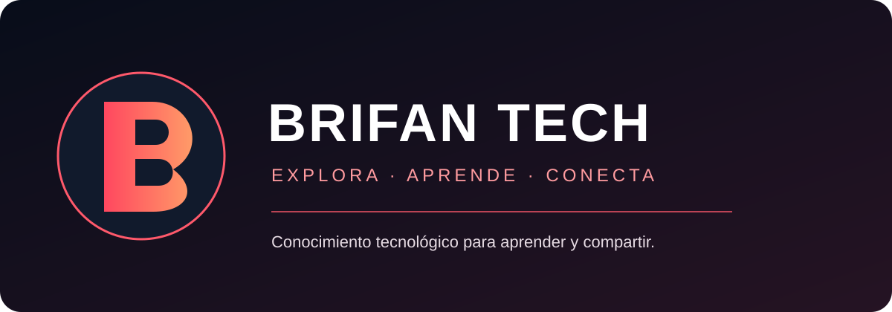

<div align="center">



# BRIFAN TECH

### Explora. Aprende. Comparte.

**Una plataforma web para descubrir, estudiar y compartir conocimiento tecnológico.**

[🌐 Abrir plataforma](https://josefro.github.io/BRIFAN-TECH/) · [📂 Código fuente](https://github.com/JOSEFRO/BRIFAN-TECH) · [🐛 Reportar un problema](https://github.com/JOSEFRO/BRIFAN-TECH/issues)

</div>

## Vista del producto


[Ver mapa de experiencia](docs/images/brifan-experience-map.svg) · [Arquitectura](docs/ARCHITECTURE.md) · [Registro de cambios](CHANGELOG.md)

> Las imágenes del repositorio son recursos de presentación y mapas conceptuales; no se presentan como capturas reales de una sesión de usuario.

## El producto

BRIFAN TECH reúne contenido y recursos sobre redes, ciberseguridad, programación, inteligencia artificial y sistemas. Su objetivo es ofrecer un espacio donde las personas puedan explorar material técnico, aprender mediante guías y participar en una comunidad.

**Es una página web: se utiliza directamente desde el navegador y no requiere instalar una aplicación.**

## Qué puedes encontrar

| Sección | Propósito |
|---|---|
| Explorar | Descubrir publicaciones, categorías y recursos tecnológicos. |
| Guías técnicas | Leer contenido estructurado con encabezados, listas, tablas y bloques de código. |
| Contenido multimedia | Consultar imágenes enlazadas y videos de YouTube integrados de forma segura. |
| Cuentas | Acceder a funciones que requieren autenticación. |
| Comunidad | Participar mediante comentarios y guardar contenido, según permisos habilitados. |
| Publicación | Crear y gestionar contenido conforme al rol y al flujo de moderación configurado. |

## Experiencia de lectura y publicación

- Lector técnico enriquecido para guías y artículos.
- Editor visual con formato, enlaces, imágenes y vista previa.
- Herramientas de edición: encabezados, listas, código, separadores y acciones de deshacer/rehacer.
- Contador de palabras y estimación de lectura en el editor.
- Interfaz adaptable a escritorio, tableta y móvil.
- Identidad visual propia con paleta oscura, acentos lima y componentes editoriales.

La disponibilidad de publicación, comentarios, favoritos y administración depende de la configuración activa de Supabase, autenticación, políticas RLS y permisos por rol.

## Tecnología

- React 19, TypeScript y Vite 7.
- Tailwind CSS 4.
- Supabase Auth, PostgreSQL y Storage.
- Lucide React.

## Ejecutar en desarrollo

Requisitos: Node.js compatible con Vite 7 y npm.

```bash
git clone https://github.com/JOSEFRO/BRIFAN-TECH.git
cd BRIFAN-TECH
npm install
```

Crea `.env.local` a partir de `.env.example` y configura las credenciales públicas de tu proyecto Supabase:

```env
VITE_SUPABASE_URL=https://TU-PROYECTO.supabase.co
VITE_SUPABASE_ANON_KEY=TU_CLAVE_PUBLICA
```

Inicia el entorno:

```bash
npm run dev
npm run build
npm run preview
```

Estos comandos son para desarrollo. La versión pública se abre desde el navegador.

## Seguridad y configuración

1. Revisa y aplica las migraciones de `supabase/` en el orden documentado.
2. Comprueba las políticas Row Level Security (RLS) de cada tabla.
3. Verifica los permisos de los buckets de Storage.
4. Prueba los flujos con cuentas de usuario y administración separadas.
5. Nunca publiques claves `service_role`, contraseñas ni secretos en el frontend o en Git.

La interfaz no sustituye la autorización del servidor: los permisos deben comprobarse en Supabase.

## Estado del proyecto

BRIFAN TECH está publicado como sitio web estático en GitHub Pages y continúa en desarrollo. La compilación y el despliegue automatizados se han ejecutado correctamente en GitHub Actions para la versión integrada.

Esto no equivale a una certificación de todos los flujos de usuario. Antes de considerar el producto listo para una comunidad amplia, deben completarse pruebas funcionales de registro, inicio de sesión, publicación, edición, eliminación, moderación, adjuntos, permisos, accesibilidad y recuperación ante errores.

## Próximas mejoras

- Validación integral de los flujos de usuario y administración.
- Pruebas de permisos y seguridad de Supabase.
- Mejoras de accesibilidad y experiencia móvil.
- Seguimiento de errores y estados vacíos.
- Ampliación de la biblioteca de guías y recursos.

## Licencia

No se ha añadido una licencia de reutilización. El código y los recursos permanecen reservados a su propietario salvo autorización expresa.
