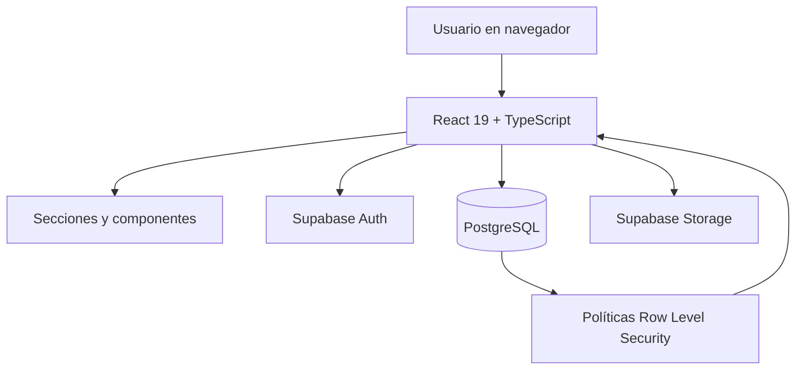

# Arquitectura de BRIFAN TECH

## Vista general

BRIFAN TECH es una aplicación web de una sola página. El navegador carga la interfaz React y utiliza Supabase como servicio de autenticación, base de datos y almacenamiento.

## Capas

| Capa | Tecnología | Responsabilidad |
|---|---|---|
| Interfaz | React 19 | Componentes, vistas y estado de la aplicación. |
| Tipado y compilación | TypeScript + Vite 7 | Verificación de tipos y empaquetado. |
| Estilos | Tailwind CSS 4 y CSS del proyecto | Diseño responsive y sistema visual. |
| Editor | Tiptap 3 | Edición enriquecida de guías y contenido. |
| Datos y autenticación | Supabase JS | Sesión, consultas y operaciones autorizadas. |
| Persistencia | PostgreSQL | Perfiles, artículos, categorías, etiquetas, comentarios y marcadores. |
| Archivos | Supabase Storage | Avatares e imágenes/contenido según las políticas del bucket. |

## Modelo de datos documentado

El esquema existente incluye las entidades `profiles`, `categories`, `articles`, `tags`, `article_tags`, `comments` y `bookmarks`.

Las relaciones y permisos efectivos deben verificarse contra las migraciones aplicadas en el proyecto Supabase. El frontend no debe considerarse una barrera de seguridad: la autorización debe aplicarse mediante RLS y políticas de Storage.

## Flujo de publicación

1. El usuario inicia sesión mediante Supabase Auth.
2. La interfaz carga su perfil y las capacidades habilitadas.
3. El editor Tiptap permite redactar y dar formato al contenido.
4. La aplicación envía las operaciones permitidas a Supabase.
5. PostgreSQL y Storage aplican sus políticas.
6. La interfaz muestra el resultado y los estados de error.

## Construcción y despliegue

- Desarrollo: `npm run dev`
- Verificación y build: `npm run build`
- Vista previa local: `npm run preview`
- Publicación: GitHub Pages mediante los workflows del repositorio.

## Límites conocidos

- El comportamiento real de cada función depende del esquema y las políticas Supabase desplegadas.
- La documentación no implica que todas las funciones administrativas estén habilitadas en producción.
- Antes de publicar cambios de esquema, comparar migraciones locales con las migraciones remotas y respaldar los datos.
- No incluir claves `service_role` ni secretos en el frontend.
